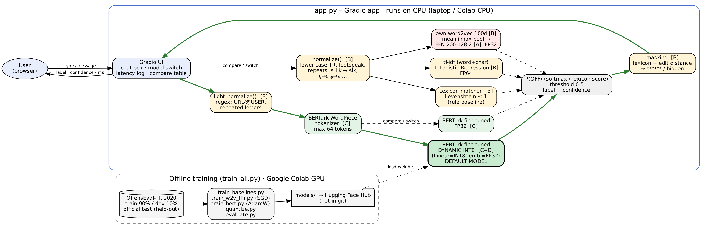

# SWE015 – Real-Time Chat Moderation (Use Case 4)

A gaming platform must flag offensive Turkish chat messages within a strict time limit on a CPU-only
server. This repository trains four models of increasing sophistication on **OffensEval-TR 2020**,
compares them on the same held-out test set, and serves the **quantized BERTurk** model in a live
Gradio chat application.

| Rung | Model | Technique area |
|---|---|---|
| Rule baseline | Offensive lexicon + minimum edit distance (Levenshtein ≤ 1) | B |
| Classical baseline | tf-idf (word 1–2 + char 2–5 grams) + logistic regression | B |
| Neural network | Own word2vec (skip-gram, 100d) → mean+max pooling → feed-forward net, SGD + backprop | A (+B) |
| Transformer | BERTurk (`dbmdz/bert-base-turkish-cased`) fine-tuned with a classification head | C |
| Quantized Transformer | Post-training **dynamic INT8** quantization of BERTurk (all `nn.Linear`) | D |

Preprocessing (B): regex normalization of noisy text – Turkish-aware lower-casing, leetspeak
(`0r0spu → orospu`), repeated letters (`çoooook → çok`), in-word separators (`s.i.k → sik`),
Turkish-to-ASCII folding. Latency budget (D): **50 ms per message on CPU**.



## Setup

```bash
git clone https://github.com/<your-username>/swe015-chat-moderation.git
cd swe015-chat-moderation
pip install -r requirements.txt
```

### macOS / Linux, one command (PyCharm or VS Code terminal)
```bash
bash run_mac.sh        # setup + quick test + full training (uses the Apple Silicon GPU via MPS)
bash run_mac.sh app    # start the app
```

### Option A – use the trained weights (fast, no GPU)
```bash
python hub.py download --repo <your-hf-username>/swe015-chat-moderation
python app.py
```

### Option B – train everything from scratch (GPU recommended, ~20–30 min on a Colab T4)
```bash
python train_all.py --quick   # optional 3–5 min smoke test of every step and the app
python train_all.py           # data → baselines → word2vec+FFN → BERTurk → INT8 → evaluation
python app.py
```
Or open `colab_run.ipynb` in Google Colab and run the cells top to bottom (`python app.py --share`
gives a public link).

**Run command:** `python app.py` → http://127.0.0.1:7860

## Repository layout

```
src/config.py        paths and hyper-parameters
src/data.py          download OffensEval-TR, fixed train/dev/test splits
src/normalize.py     regex normalization (B)
src/lexicon.py       lexicon + Levenshtein matcher (B)
src/models.py        inference wrappers used by BOTH evaluate.py and app.py
train_baselines.py   lexicon + tf-idf/LR
train_w2v_ffn.py     word2vec + feed-forward network (SGD)
train_bert.py        BERTurk fine-tuning
quantize.py          dynamic INT8 quantization
evaluate.py          results table: macro-F1, size (MB), latency (ms, ≥100 runs, CPU)
app.py               Gradio chat application
hub.py               push / download weights (weights are not stored in git)
fill_slides.py       fills docs/slides_template.pptx with the measured results → presentation.pptx
```

## Evaluation protocol

* Training data: official OffensEval-TR training set (31,756 tweets), split 90 % train / 10 % dev (stratified, seed 42).
  The dev split is used only for model selection.
* Test data: the official OffensEval-TR test set (3,528 tweets), identical for every model.
* Metric: macro-F1 (classes are imbalanced, ~19 % offensive); OFF-class F1 and accuracy are also reported.
* Size: size of the model files on disk.
* Latency: one message per call (batch size 1), CPU, mean and p95 over 200 runs after 10 warm-up calls.
  The hardware is written to `results/results.md`.

## Results

Test set: official OffensEval-TR 2020 test split, n = 3528 (20.3% offensive)

Latency hardware: arm | 14 logical cores | torch threads = 10 | Darwin
Latency: batch size 1, mean / p95 over 200 runs, budget = 50.0 ms

| key       | model                            |   macro_F1 |   OFF_F1 |   accuracy |   size_MB |   latency_ms_mean |   latency_ms_p95 | meets_budget   |
|:----------|:---------------------------------|-----------:|---------:|-----------:|----------:|------------------:|-----------------:|:---------------|
| lexicon   | Lexicon + edit distance (rules)  |     0.6212 |   0.4363 |     0.7115 |       0   |              0.02 |             0.06 | True           |
| tfidf     | tf-idf + Logistic Regression     |     0.7671 |   0.6299 |     0.8478 |       5.1 |              0.55 |             0.73 | True           |
| w2v_ffn   | word2vec + feed-forward NN       |     0.6768 |   0.4958 |     0.7781 |      23.7 |              0.05 |             0.09 | True           |
| bert_fp32 | BERTurk fine-tuned (FP32)        |     0.8122 |   0.6949 |     0.8855 |     442.5 |             28.43 |            34.34 | True           |
| bert_int8 | BERTurk dynamic INT8 (quantized) |     0.8178 |   0.7033 |     0.8897 |     186   |             15.51 |            28.28 | True           |

Generated by `python evaluate.py` (see also `results/report.txt`).

## Data & citation

Çöltekin, Ç. (2020). *A Corpus of Turkish Offensive Language on Social Media.* LREC 2020, pp. 6174–6184.
Data: https://coltekin.github.io/offensive-turkish/ (CC-BY). BERTurk: Schweter, S. (2020), `dbmdz/bert-base-turkish-cased`.
